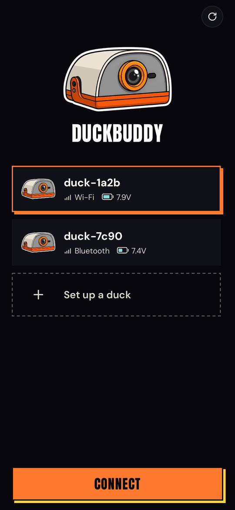
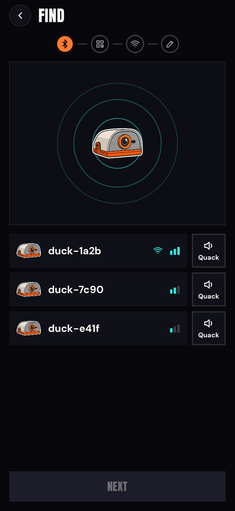
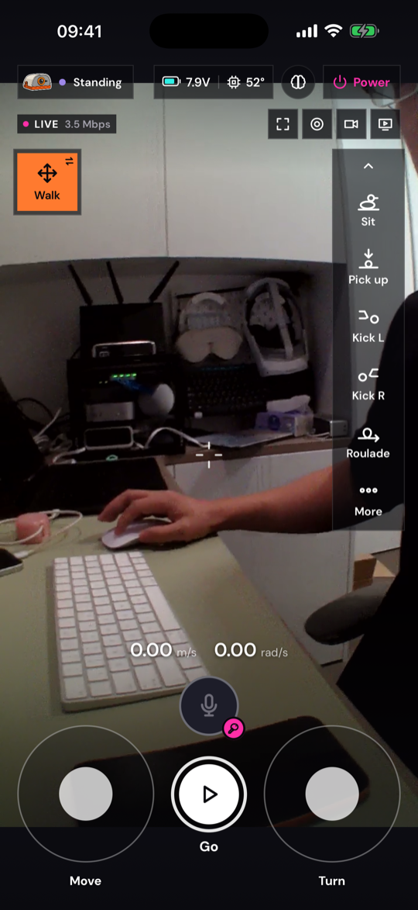
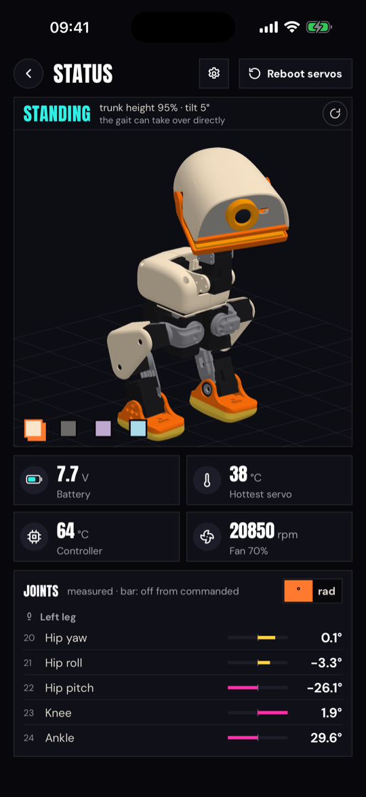
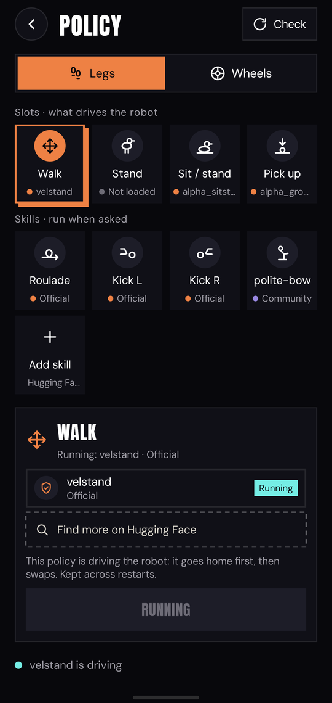
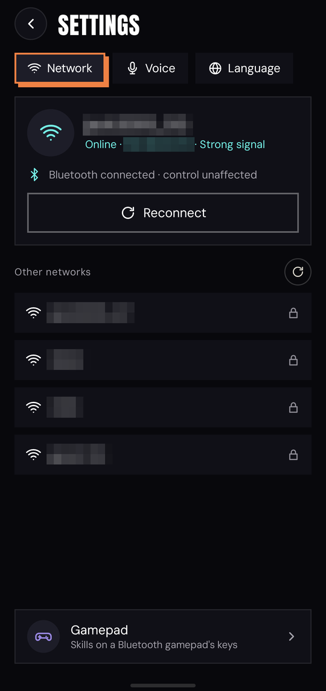
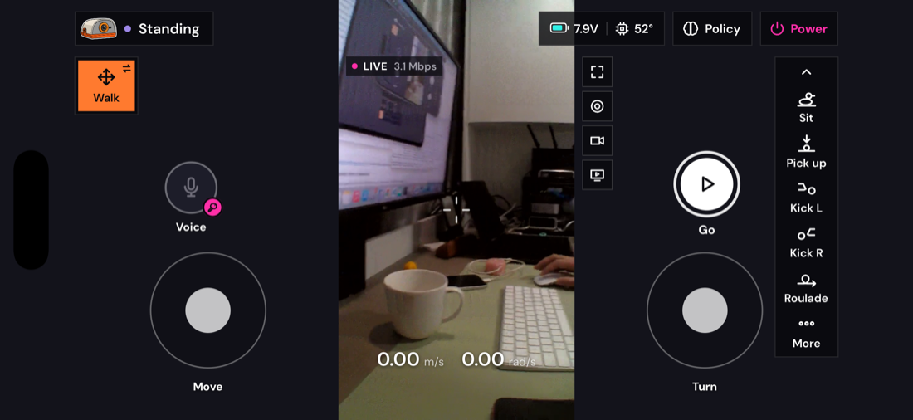
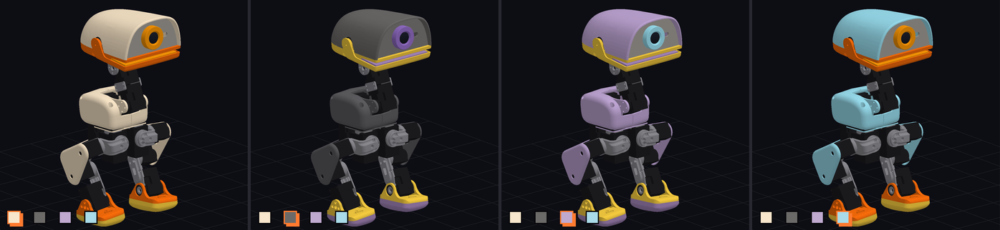
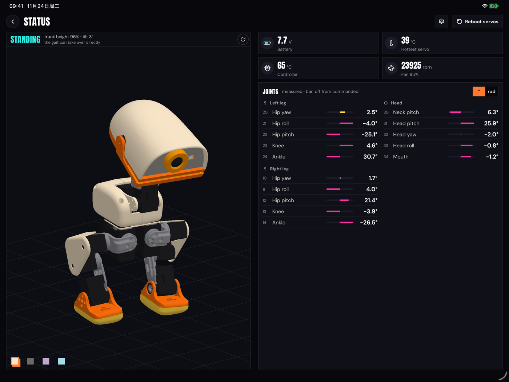

# DuckBuddy App

[简体中文](README.md) | **English**

> **Unofficial app**: DuckBuddy is an independent community project. It is not an official Pollen Robotics app and is not affiliated with or endorsed by Pollen Robotics or Hugging Face. See [Copyright and license](#license).

The phone app for Microduck, built natively for iOS and Android: add a robot, drive it, run moves, swap policies, check its status and change its network. The screens adapt to phones in portrait and landscape, iPad and Android tablets, iPhone Duo and Android foldables.

- Package / bundle ID: `robot.duckbuddy.microduck`
- Requirements: [docs/prd.md](docs/prd.md)　Technical design: [docs/technical-design.md](docs/technical-design.md) (both in Chinese)

## Contents

- [Screenshots](#screenshots)
- [Features](#features)
- [Project layout](#layout)
- [Requirements](#requirements)
- [Build and run](#build)
- [Demo mode](#demo)
- [Adaptive layout](#adaptive)
- [Security and privacy](#security)
- [Tests and design checks](#testing)
- [Not done yet](#todo)
- [Copyright and license](#license)

<a id="screenshots"></a>

## Screenshots

Taken on a real Android phone (portrait, 450×1000 dp) connected to the bench robot: the video, battery, temperatures, posture and policies are all live. The Wi-Fi names and IP on the Settings page are blurred.

<p>






</p>

Driving with the phone in landscape:



The 3D model on the Status screen comes in the four official colourways (Cream, Graphite, Lavender, Sky). Pick one at the bottom left of the 3D view; each robot remembers its own:



Wide two-pane layout (the same phone temporarily set to a tablet size, about 990×720 dp in landscape):



<a id="features"></a>

## Features

| Screen | What it does |
| --- | --- |
| Connect | Robots you've added (link type, voltage); select one and connect; rescan |
| Set up a duck | Find the duck → verify by scanning the QR code or pasting the `md1:` setup code (leave it empty for a robot without one, which then pairs with the factory PIN) → join Wi-Fi (skipped if the robot is already online) → name it |
| Drive | 9:16 video, four stick modes (walk / head / look / height), an action column that changes with the mode, a **More** tray (three play modes and 13 emotions; beside the video in wide windows; tap outside to close), the Start key (hold 1.5 s to return home), the power key (while held, a bar fills and the label says what letting go will do: 2 s rests, 4 s powers off), a camera toggle, photos (JPEG) and recording (H.264 + AAC MP4; the audio is the phone mic, silent without mic access), saved to the photo library and turned upright for the camera mount, and hold-to-talk. Video and the sticks use WebRTC to the robot's `mediad` |
| Status | Live 3D pose (in any of the four official colourways, battery on the back), posture, battery / hottest servo / controller temperature / fan speed (optional, see [`robot/fanstat`](robot/fanstat/README.md); hidden when it isn't installed on the robot), measured angle and deviation bar for all 15 servos, reboot servos |
| Policy | Legs / wheels, slots and skills, load / reset to official / turn a slot off, check for updates, search and download from Hugging Face |
| Gamepad | Bind skills or emotions to A B X Y LB RB, reset to defaults (opened from the bottom of Settings) |
| Settings | Network (current network, reconnect, switch), Voice (test and save a Doubao key, spoken replies), Language (中文 / English) |

Emotions: since robot 0.18.8 (API 49) every release ships 13 head, body, beak and sound animations — yes, no, excited, laugh, curious, hmm, sad, angry, impatient, defiant, tease, crushed (sits down at the end) and nod fast — played with `robot.do <name>`. The robot must be started and standing, and plays one at a time. On older robots, yes / no / excited fall back to the app's own head moves and quacks.

Play modes (0.23.0 and later): laser chase, soccer (finds the purple ball, walks to it and kicks it) and free play. Once on, the robot's own camera and brain drive it. In laser chase and soccer, pushing a stick takes over at any time (the robot lets a deflected stick win); free play only yields to a physical pad, so pushing an app stick switches free play off and hands you the controls. One runs at a time, as with the NFC mode tags. They go over the video link when it's open, otherwise over Bluetooth (API 67). Drive asks the robot which one is on every 3 s, so the state pill shows "Playing soccer" and so on, even when a tag or the pad switched it.

Voice control: hold the mic and talk. It only runs if you slide up to **Send** before letting go; sliding to **Cancel** or releasing in place discards it. Doubao's realtime voice model works out what you meant, the robot answers with moves and quacks, and the phone says one short line about the result.

<a id="layout"></a>

## Project layout

```
  core/          Shared Rust core (UniFFI generates the Swift / Kotlin bindings)
    src/           link: BLE session and Noise auth · calls: typed calls · results: reply decoding · state: posture
                   drive: stick mapping · viewer: 3D model and kinematics · voice: voice turns · manifest: compatibility
    scripts/       build-ios.sh · build-android.sh
  shared/        Resources used by both apps
    i18n/strings.json   The only source of UI text (Chinese / English)
    icons.json          Icons from the design (gen.py generates code for both apps)
    fonts/ images/      Anton and DM Sans (OFL), duck images, demo video
    models/             3D model duck-web-mouth-v2.bin (official MJCF meshes; upstream CC BY-SA-NC model license;
                        each part tagged with its official material role, colours come from the core)
  ios/           SwiftUI project (Metal 3D, CoreBluetooth, VisionKit QR scanning)
  android/       Jetpack Compose project (OpenGL ES 3D, WindowManager for foldables, CameraX + ML Kit QR scanning)
  docs/          PRD, technical design, screenshots
```

The protocol is not rewritten in the app. The core depends directly on `duck-ipc-proto`, `duck-ble`, `duck-auth` and `kinematics` from the official `pollen-robotics/microduck` repository, tracking `main`, so a change to the official protocol breaks the core's build. No RPC method names appear in the Swift or Kotlin code.

<a id="requirements"></a>

## Requirements

| For | Version |
| --- | --- |
| Rust | 1.89+, with targets `aarch64-apple-ios`, `aarch64-apple-ios-sim`, `aarch64-linux-android`, `armv7-linux-androideabi`, `x86_64-linux-android` (the build scripts run `rustup target add` for you) |
| iOS | Xcode 26, iOS 17+ |
| Android | Android SDK 36, an NDK (the newest installed one is used), JDK 17+ (Android Studio's bundled JBR works), minSdk 26 |

<a id="build"></a>

## Build and run

Generate the core bindings for both apps first (again whenever the core changes):

```bash
core/scripts/build-ios.sh        # → ios/DuckCore/ (xcframework + Swift bindings)
core/scripts/build-android.sh    # → android/app/src/main/{jniLibs,java/uniffi}
```

After editing `shared/icons.json`, regenerate the icon code:

```bash
python3 shared/gen.py
```

**iOS**: open `ios/DuckBuddy.xcodeproj` in Xcode and run, or from the command line:

```bash
cd ios
xcodebuild -project DuckBuddy.xcodeproj -target DuckBuddy -sdk iphonesimulator build
```

**Android**:

```bash
cd android
./gradlew :app:assembleDebug
adb install -r app/build/outputs/apk/debug/app-debug.apk
```

Core unit tests:

```bash
cd core && cargo test
```

Generated files (`DuckCore/`, `jniLibs/`, `java/uniffi/`, `target/` and the Gradle build folders) are in `.gitignore` and aren't committed.

**Packaging**: each script generates the core bindings first, then builds the package (CI runs the same scripts on the same Mac):

```bash
android/scripts/package.sh <output dir> [version] [build]   # release APK, signed with this Mac's debug key
TEAM=<Apple team ID> ios/scripts/package.sh <output dir> [version] [build]   # dev-signed ipa + dSYMs; installs only on registered devices
```

The Gitea workflow `.gitea/workflows/package.yml` runs both scripts on a self-hosted macOS runner (label `macos`), signing with the team in the `APPLE_TEAM_ID` repo variable, when a `v*` tag is pushed (or when run by hand from the Actions page) and attaches the files to the run. With a `PKG_TOKEN` secret set, it also publishes them to the Gitea generic package `duckbuddy/<version>`.

<a id="demo"></a>

## Demo mode

Every screen works without a robot. The demo duck answers in the same format as the official protocol, decoded by the same core.

| Platform | How to start |
| --- | --- |
| iOS | Launch argument `-demo`; optionally `-route drive\|status\|policy\|gamepad\|settings\|setup`, `-simulateWindow 820x904`, `-started`, `-en`, `-colourway cream\|graphite\|lavender\|sky` |
| Android | `adb shell am start -n robot.duckbuddy.microduck/.MainActivity --ez demo true`; optionally `--es route drive`, `--es window 390x844`, `--ez en true`, `--es colourway sky` |

`-simulateWindow` / `window` confines the UI to a window of the given size, for checking layouts that have no matching simulator (such as the iPhone Duo's inner and outer screens).

Simulators have no Bluetooth. For real video, add `-webrtc <robot IP>` (Android `--es webrtc <IP>`): video and the sticks then go to the real robot's `mediad`, and everything else stays demo data. `-stick walk|head|look|height:<lx>,<ly>,<rx>,<ry>:<seconds>` (Android `--es stick …`) holds a stick for a while after launch. `-tray` (Android `--ez tray true`) opens the More tray after launch, for screenshots. `-capture photo|record:<seconds>` (Android `--es capture …`) takes a photo or records a clip once video is live.

<a id="adaptive"></a>

## Adaptive layout

Both apps use the same rules, based on **the window's actual size** rather than the device model:

| Class | Condition | Typical devices |
| --- | --- | --- |
| Narrow portrait | width < 600 | Phone in portrait, foldable cover screen, iPhone Duo outer screen, narrow tablet split view |
| Short landscape | height < 500 | Phone in landscape |
| Near-square | width ≥ 600 and aspect ratio < 1.3 | Unfolded foldable, unfolded iPhone Duo, tablet in portrait |
| Wide | anything else | Tablet in landscape, wide windows |

- On phones, elements are placed at the design's coordinates, scaled (390×844 portrait, 844×390 landscape).
- Wide windows use two panes. On the Drive screen the video sits on top, the sticks hug the outer edges, and the voice and Start keys sit either side of the centre line, never on the crease.
- **Android foldables**: Jetpack WindowManager reports where the fold is. With a vertical fold, the two panes split exactly at it. Android doesn't report a fold lying flat as separating, but the crease is still there, so the app splits there too. In tabletop posture (horizontal fold, half open) the video stays in the top half and every control goes in the bottom half.
- **iPhone Duo**: iOS has no public hinge API, so it's handled by window size. Unfolded, the window is near-square and gets two equal panes that meet at the crease.
- Folding, unfolding, rotating and split view only change the layout. Connection and driving state live in the model, so nothing is interrupted.

<a id="security"></a>

## Security and privacy

- In secure mode, Bluetooth uses the official Noise handshake (`Noise_NNpsk0_25519_ChaChaPoly_SHA256`) and every request after it is encrypted. Older robots use the factory PIN, which the app sends silently.
- Setup codes and the Doubao key are kept only in the system's secure storage (iOS Keychain, `ThisDeviceOnly`; Android Keystore AES-GCM, excluded from cloud backup and device transfer), never in the robot list file.
- Users enter their own Doubao key; the app ships with none and only ever shows its last 4 characters.
- Sound is uploaded only while the mic is held, voice needs separate consent on first use, and no recordings are kept.
- When the app goes to the background, it closes the video and control channels at once, and the robot's dead-man switch stops it within about 0.6 s.

<a id="testing"></a>

## Tests and design checks

- Core: `cargo test` (49 tests), covering the Noise handshake against the official `duck-auth` robot side, wrong keys, PIN mode, refusing robots that are too old, posture classification (on samples from the official `posture.rs`), holding / cancelling voice commands and their time and speed caps, loading the repository's 3D model, checking the four colourways against the official swatches, the emotion list and its `robot.do` calls, and the play modes' version checks, one-at-a-time switching and `robot.mode` decoding.
- Continuous integration: GitHub Actions (`.github/workflows/ci.yml`) runs on every push to main and every pull request. It runs the core tests, checks that the generated icon code is up to date, and builds debug versions of both apps (no signing, no secrets).
- Design checks: each app has a screenshot script that captures every page in several window sizes, for comparison against the design:

```bash
ios/scripts/screenshots.sh <output dir> [pages...]       # on an iPad simulator, emulating phone portrait / landscape and the Duo's outer / inner screens
android/scripts/screenshots.sh <output dir> [pages...]   # needs a running emulator (e.g. Pixel Fold)
```

<a id="todo"></a>

## Not done yet

- **The teleop (unreliable) data channel**: robot 0.17.8 only creates `control`, so the sticks use `control` for now.
- **Secure (Noise setup-code) mode**: robot 0.17.8's `btd` doesn't support it yet, and a user-set PIN can't be entered in the app yet.
- **Detecting the colourway**: robots don't report their colour, so it defaults to Cream until the user picks one on the Status screen.
- **Waiting on Pollen** (technical design §8): the body height / lean API (height mode only moves the head for now), writing "allow community downloads" from the phone (currently app-side only), and making a robot quack before authentication (currently shown in demo mode only).

<a id="license"></a>

## Copyright and license

- **Unofficial**: DuckBuddy is an independent community project. It is **not** an official product of Pollen Robotics or Hugging Face, and is not affiliated with, endorsed by or supported by them. Please report problems in this repository, not to Pollen Robotics. "Pollen Robotics", "Microduck" and related names and logos belong to their owners and are used here only to describe compatibility.
- **License**: released under the [Apache License 2.0](LICENSE), the same license as the official [`pollen-robotics/microduck`](https://github.com/pollen-robotics/microduck). Copyright 2026 DuckBuddy contributors.
- **Third party**: the core depends on the official `duck-ipc-proto`, `duck-ble`, `duck-auth` and `kinematics` crates (© Pollen Robotics, Apache-2.0, unmodified). The 3D model and the four colourways come from the Microduck model on Pollen Robotics' website, and the robot's design belongs to Pollen Robotics. The Anton and DM Sans fonts are SIL OFL 1.1; WebRTC is BSD 3-Clause. The full list is in [NOTICE](NOTICE).
- **No warranty**: the software is provided "as is", without warranty of any kind. Driving, updating or reconfiguring a robot with it is at your own risk.
