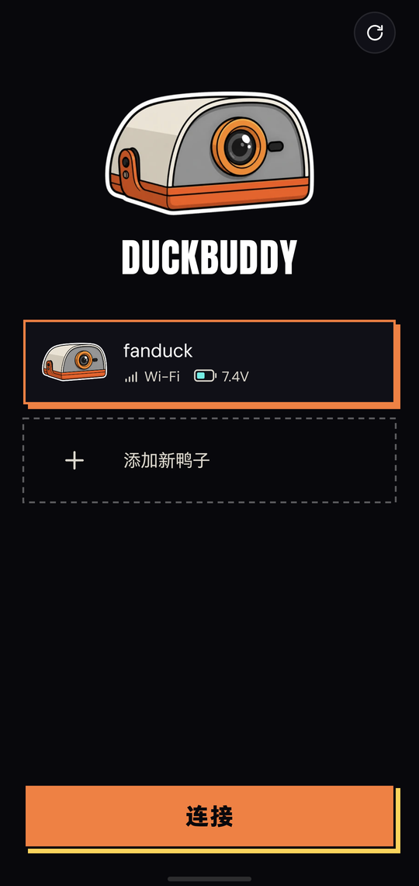
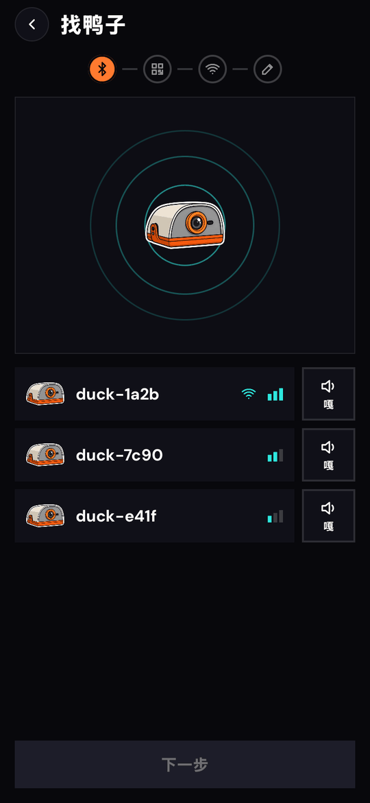
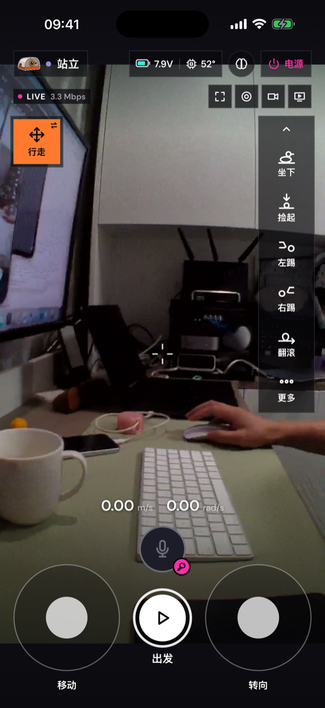
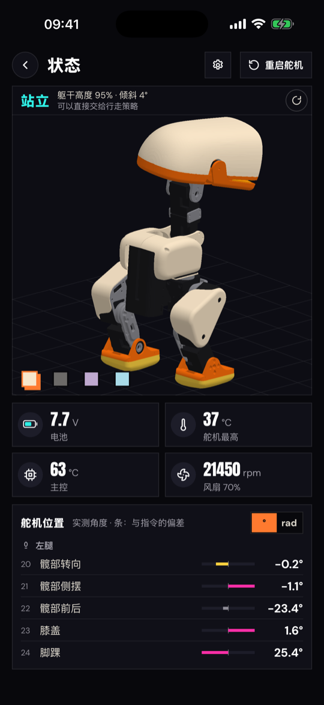
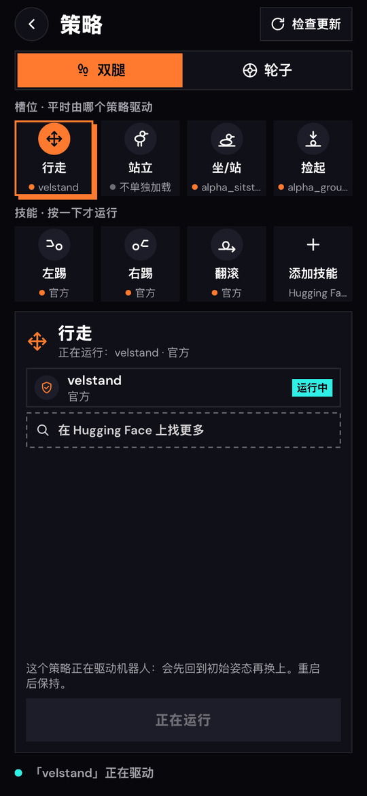
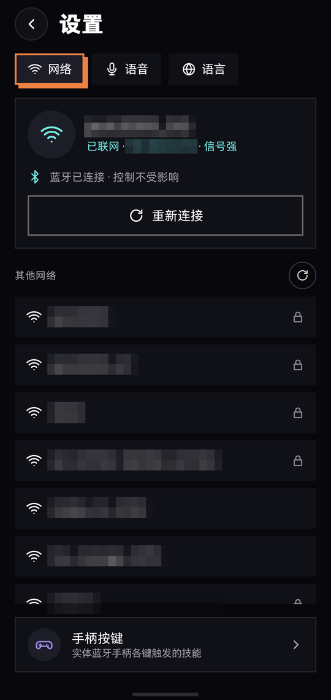
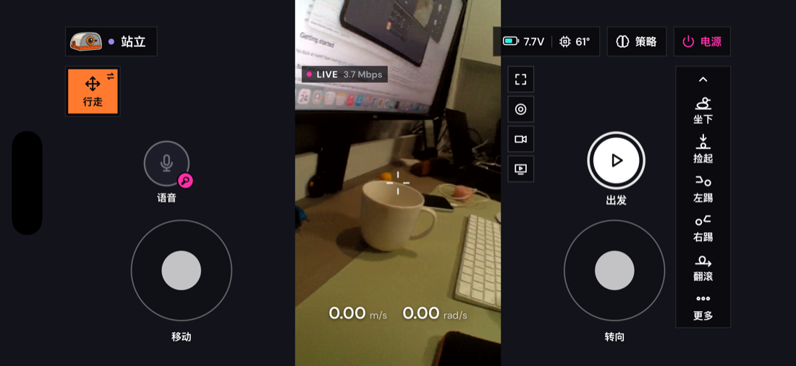
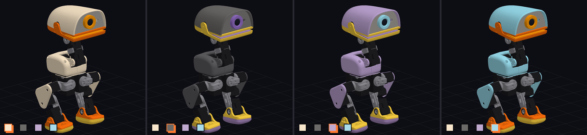
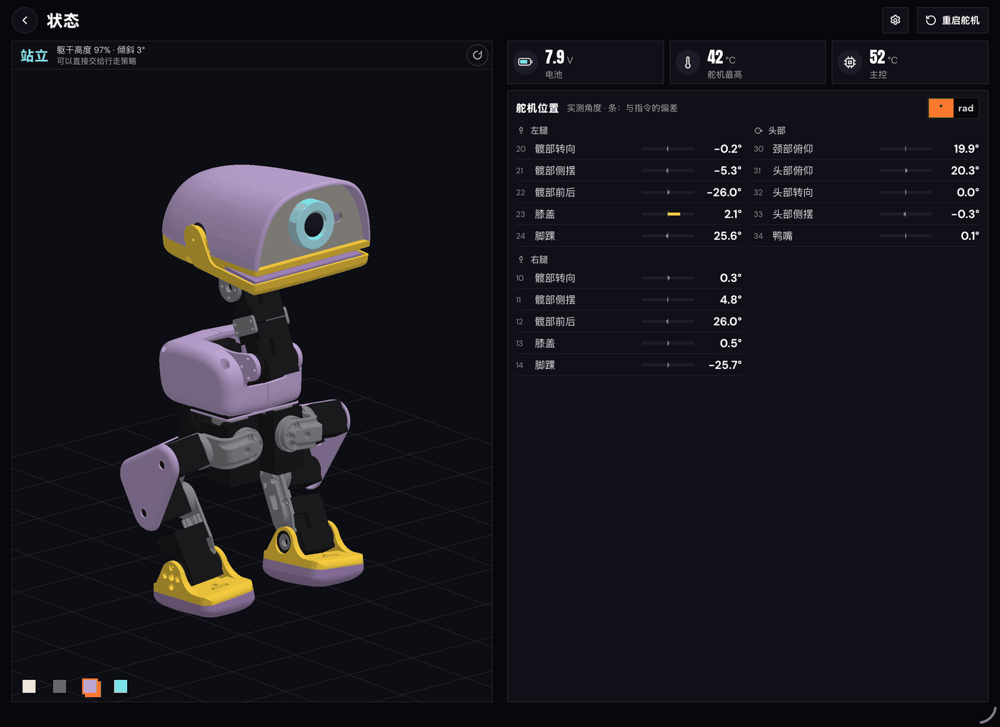

# DuckBuddy App

**简体中文** | [English](README.en.md)

> **非官方 App**：DuckBuddy 是独立的社区作品，不是 Pollen Robotics 的官方 App，与 Pollen Robotics / Hugging Face 没有隶属或背书关系。详见[版权与许可](#license)。

Microduck 的手机 App，iOS 和 Android 均为原生开发：添加机器人、驾驶、做动作、换策略、看状态、改网络。支持手机横竖屏、iPad / Android 平板、iPhone Duo 和 Android 折叠屏。

- 包名 / Bundle ID：`robot.duckbuddy.microduck`
- 需求：[docs/prd.md](docs/prd.md)　方案：[docs/technical-design.md](docs/technical-design.md)

## 目录

- [界面截图](#screenshots)
- [功能](#features)
- [工程结构](#layout)
- [环境要求](#requirements)
- [构建与运行](#build)
- [演示模式](#demo)
- [自适应布局](#adaptive)
- [安全与隐私](#security)
- [测试与设计对照](#testing)
- [尚未完成](#todo)
- [版权与许可](#license)

<a id="screenshots"></a>

## 界面截图

安卓真机（竖屏 450×1000 dp）连接实验台上的机器人截取：视频、电量、温度、姿态、策略都是实时数据。设置页的 Wi-Fi 名和 IP 已打码。

<p>






</p>

手机横屏驾驶：



状态页 3D 模型使用官方四种配色（奶油 / 石墨 / 薰衣草 / 天蓝），在 3D 视图左下角选择，按机器人记住：



宽屏两栏（同一台手机临时改成平板尺寸，横屏约 990×720 dp）：



<a id="features"></a>

## 功能

| 页面 | 内容 |
| --- | --- |
| 连接 | 已添加的机器人（连接方式、电压），选中后连接；重新扫描 |
| 添加新鸭子 | 找鸭子 → 扫码或粘贴 `md1:` 设置码验证（没有设置码的机器人留空，走出厂 PIN）→ 连 Wi-Fi（已联网自动跳过）→ 起名字 |
| 驾驶 | 9:16 视频框、四种摇杆模式（行走 / 头部 / 边走边看 / 高度）、随模式变化的动作列、「更多」托盘（三个玩法 + 13 个情绪动作，宽屏时放在视频旁边，点外面收起）、启动键（长按 1.5 s 回初始姿态）、电源键（长按时进度条走动、文字提示松手的结果：2 s 休息、4 s 关机）、摄像头开关、拍照（JPEG）和录像（H.264 + AAC 的 MP4，音轨是手机麦克风，没有权限时为静音），存进系统相册、按画面安装角度转正、按住说话。视频和摇杆走机器人 `mediad` 的 WebRTC |
| 状态 | 实时 3D 姿态（官方四种配色可选，背后带电池）、站姿判定、电池 / 舵机最高温度 / 主控温度 / 风扇转速（可选，见 [`robot/fanstat`](robot/fanstat/README.md)；没装时不显示这一格）、15 个舵机的实测角度与偏差条、重启舵机 |
| 策略 | 双腿 / 轮子切换、槽位与技能、加载 / 恢复官方 / 关闭槽位、检查更新、在 Hugging Face 搜索与下载 |
| 手柄按键 | 为 A B X Y LB RB 绑定技能或情绪动作、恢复默认（入口在设置页底部） |
| 设置 | 网络（当前网络、重连、换网）、语音（豆包密钥测试并保存、语音播报）、语言（中文 / English） |

情绪动作：机器人 0.18.8（API 49）起自带 13 个"头 + 身体 + 嘴 + 声音"的动画——点头、摇头、兴奋、大笑、好奇、嗯…、难过、生气、不耐烦、不服、做鬼脸、崩溃（播完会坐下）、快点头，用 `robot.do <名字>` 播放。要先启动并站着，一次只播一个。更旧的机器人上，点头 / 摇头 / 兴奋退回 App 自己用头部和叫声模拟。

玩法（0.23.0 起）：追激光、踢球（自己找紫色的球、走过去踢）、自由活动。打开后由机器人自己的摄像头和大脑带着走。追激光和踢球时推摇杆随时接管（机器人让推动的摇杆优先）；自由活动只给实体手柄让路，所以推 App 的摇杆会直接关掉自由活动、由你来开。一次只玩一个，和 NFC 模式卡一样。视频连着时走视频通道，否则走蓝牙（需要 API 67）。驾驶页每 3 秒读一次机器人当前在玩什么，状态胶囊会显示"追激光中"等，用 NFC 卡或手柄切换的也能看到。

语音控制：按住麦克风说话，上划到「发送」松开才执行，上划到「取消」或原地松开不执行。语音由豆包实时语音大模型理解，机器人用动作和叫声回应，手机只播报一句很短的执行结果。

<a id="layout"></a>

## 工程结构

```
  core/          共享 Rust 核心（UniFFI 生成 Swift / Kotlin 绑定）
    src/           link 蓝牙会话与 Noise 认证 · calls 类型化调用 · results 回复解码 · state 站姿
                   drive 摇杆映射 · viewer 3D 模型与运动学 · voice 语音轮次 · manifest 兼容判定
    scripts/       build-ios.sh · build-android.sh
  shared/        两端共用资源
    i18n/strings.json   唯一文案源（中 / 英）
    icons.json          设计稿图标（gen.py 生成两端代码）
    fonts/ images/      Anton、DM Sans（OFL）、鸭子图片、演示画面
    models/             3D 模型 duck-web-mouth-v2.bin（官方 MJCF 网格，按上游 CC BY-SA-NC 模型许可；
                        每个部件标注官网材质角色，配色由核心给出）
  ios/           SwiftUI 工程（Metal 3D、CoreBluetooth、VisionKit 扫码）
  android/       Jetpack Compose 工程（OpenGL ES 3D、WindowManager 折叠屏、CameraX + ML Kit 扫码）
  docs/          PRD、技术方案、界面截图
```

协议不在 App 里重写：核心直接依赖官方 `pollen-robotics/microduck` 的 `duck-ipc-proto`、`duck-ble`、`duck-auth`、`kinematics`（跟随 `main`），官方协议一改，核心就编译失败。Swift / Kotlin 代码里不出现 RPC 方法名。

<a id="requirements"></a>

## 环境要求

| 用途 | 版本 |
| --- | --- |
| Rust | 1.89+，加上目标 `aarch64-apple-ios`、`aarch64-apple-ios-sim`、`aarch64-linux-android`、`armv7-linux-androideabi`、`x86_64-linux-android`（构建脚本会自动 `rustup target add`） |
| iOS | Xcode 26，iOS 17+ |
| Android | Android SDK 36、NDK（取最新已装版本）、JDK 17+（可用 Android Studio 自带 JBR），minSdk 26 |

<a id="build"></a>

## 构建与运行

先生成两端的核心绑定（核心代码改动后重新执行）：

```bash
core/scripts/build-ios.sh        # → ios/DuckCore/（xcframework + Swift 绑定）
core/scripts/build-android.sh    # → android/app/src/main/{jniLibs,java/uniffi}
```

改了 `shared/icons.json` 后重新生成两端图标代码：

```bash
python3 shared/gen.py
```

**iOS**：用 Xcode 打开 `ios/DuckBuddy.xcodeproj` 运行；或命令行：

```bash
cd ios
xcodebuild -project DuckBuddy.xcodeproj -target DuckBuddy -sdk iphonesimulator build
```

**Android**：

```bash
cd android
./gradlew :app:assembleDebug
adb install -r app/build/outputs/apk/debug/app-debug.apk
```

核心单元测试：

```bash
cd core && cargo test
```

生成物（`DuckCore/`、`jniLibs/`、`java/uniffi/`、`target/`、Gradle 构建目录）已在 `.gitignore` 中，不提交。

**打安装包**：两个脚本各自先生成核心绑定，再出包（同一台 Mac 上 CI 跑的也是它们）：

```bash
android/scripts/package.sh <输出目录> [版本号] [构建号]   # release APK，用本机 debug 密钥签名
TEAM=<Apple 团队 ID> ios/scripts/package.sh <输出目录> [版本号] [构建号]   # dev 签名 ipa + dSYM，只能装到已注册的设备
```

Gitea 工作流 `.gitea/workflows/package.yml` 在打 `v*` 标签时（或在 Actions 页手动运行）在自建的 macOS runner（标签 `macos`）上执行这两个脚本，签名团队取自仓库变量 `APPLE_TEAM_ID`，产物挂在运行页上；配了 `PKG_TOKEN` 时另发到 Gitea 通用软件包 `duckbuddy/<版本号>`。

<a id="demo"></a>

## 演示模式

不连机器人也能走完全部页面。演示鸭子的回复格式与官方协议一致，并经过同一套核心解码。

| 平台 | 启动方式 |
| --- | --- |
| iOS | 启动参数 `-demo`；可加 `-route drive\|status\|policy\|gamepad\|settings\|setup`、`-simulateWindow 820x904`、`-started`、`-en`、`-colourway cream\|graphite\|lavender\|sky` |
| Android | `adb shell am start -n robot.duckbuddy.microduck/.MainActivity --ez demo true`；可加 `--es route drive`、`--es window 390x844`、`--ez en true`、`--es colourway sky` |

`-simulateWindow` / `window` 把界面限制在指定窗口尺寸里，用来在没有对应模拟器时检查布局（例如 iPhone Duo 内屏、外屏）。

模拟器没有蓝牙，想看真视频可加 `-webrtc <机器人 IP>`（Android `--es webrtc <IP>`）：视频和摇杆接真机的 `mediad`，其余仍是演示数据。`-stick walk|head|look|height:<lx>,<ly>,<rx>,<ry>:<秒>`（Android `--es stick …`）启动后按住摇杆一段时间。`-tray`（Android `--ez tray true`）启动后打开「更多」托盘，方便截图。`-capture photo|record:<秒>`（Android `--es capture …`）出画面后拍一张或录一段。

<a id="adaptive"></a>

## 自适应布局

两端用同一套规则，只看**当前窗口的实际尺寸**，不看设备型号：

| 类别 | 条件 | 典型设备 |
| --- | --- | --- |
| 窄竖屏 | 宽 < 600 | 手机竖屏、折叠屏外屏、iPhone Duo 外屏、平板窄分屏 |
| 矮横屏 | 高 < 500 | 手机横屏 |
| 接近正方形 | 宽 ≥ 600 且宽高比 < 1.3 | 折叠屏展开、iPhone Duo 展开、平板竖屏 |
| 宽屏 | 其他 | 平板横屏、宽窗口 |

- 手机按设计稿坐标等比放置（竖屏 390×844、横屏 844×390）。
- 宽窗口为两栏；驾驶页视频在上，摇杆贴住左右外缘，语音键和启动键在中线两侧，不压在折痕上。
- **Android 折叠屏**：通过 Jetpack WindowManager 读取折痕位置。有竖直折痕时两栏以折痕为界（展平时系统不把折痕报告为分隔，但折痕仍在，同样处理）；桌面姿态（水平折痕半开）时视频只占上半屏，控件全部在下半屏。
- **iPhone Duo**：iOS 没有公开的铰链接口，按窗口尺寸处理；展开后接近正方形，两栏等分，正好落在折痕两侧。
- 折叠 / 展开、旋转、分屏只改变布局，连接和驾驶状态保留在模型里，不会中断。

<a id="security"></a>

## 安全与隐私

- 安全模式下蓝牙走官方 Noise 握手（`Noise_NNpsk0_25519_ChaChaPoly_SHA256`），之后全部请求加密；旧机器人走出厂 PIN，由 App 静默发送。
- 设置码和豆包密钥只存在系统安全存储（iOS Keychain `ThisDeviceOnly`；Android Keystore AES-GCM，并从云备份和设备迁移中排除），不写进机器人列表文件。
- 豆包密钥由用户自己填写，App 不内置任何密钥；界面只显示末 4 位。
- 只在按住麦克风期间上传声音，首次使用单独征得同意，不保存录音。
- App 进入后台立即关闭视频与控制通道，机器人的"死人开关"约 0.6 s 内停下。

<a id="testing"></a>

## 测试与设计对照

- 核心：`cargo test`（49 项），包括与官方 `duck-auth` 机器人端的 Noise 握手互通、错误密钥、PIN 模式、旧版本机器人拒绝、站姿判定（官方 `posture.rs` 样本）、语音的攒住 / 取消 / 限时限速、加载仓库里的 3D 模型并检查四种配色与官网色块一致、情绪清单与 `robot.do` 请求、玩法的版本判断 / 互斥切换 / `robot.mode` 解码。
- 设计对照：两端各有截图脚本，按页面 × 窗口批量截图，与设计稿逐页比较：

```bash
ios/scripts/screenshots.sh <输出目录> [页面...]       # iPad 模拟器上模拟手机竖 / 横屏、Duo 外屏 / 内屏
android/scripts/screenshots.sh <输出目录> [页面...]   # 需要已启动的模拟器（例如 Pixel Fold）
```

<a id="todo"></a>

## 尚未完成

- **teleop（不可靠）数据通道**：机器人 0.17.8 只建 `control` 通道，摇杆目前走 `control`。
- **安全（Noise 设置码）模式**：机器人 0.17.8 的 `btd` 还不支持；App 里还不能输入用户自设的 PIN。
- **配色识别**：机器人不会报告自己的配色，默认奶油色，需要用户在状态页选一次。
- **待官方确认**（技术方案 §8）：机身高度 / 侧倾接口（高度模式目前只控制头部）、手机端写入"允许下载社区策略"（目前只在 App 内生效）、认证前让机器人叫一声（目前只在演示模式显示）。

<a id="license"></a>

## 版权与许可

- **非官方**：DuckBuddy 是独立的社区作品，**不是** Pollen Robotics 或 Hugging Face 的官方产品，与其没有隶属、授权或背书关系，也不由其提供支持；使用中遇到问题请在本仓库反馈，不要找 Pollen Robotics。"Pollen Robotics"、"Microduck" 等名称和标识归各自权利人所有，这里只用来说明兼容对象。
- **许可**：本项目以 [Apache License 2.0](LICENSE) 发布，与官方 [`pollen-robotics/microduck`](https://github.com/pollen-robotics/microduck) 相同。Copyright 2026 DuckBuddy contributors。
- **第三方**：核心依赖官方的 `duck-ipc-proto`、`duck-ble`、`duck-auth`、`kinematics`（© Pollen Robotics，Apache-2.0，未修改）；3D 模型与四种配色取自 Pollen Robotics 官网的 Microduck 模型，机器人外观设计归 Pollen Robotics；字体 Anton、DM Sans 为 SIL OFL 1.1；WebRTC 为 BSD 3-Clause。完整清单见 [NOTICE](NOTICE)。
- **免责**：软件按"原样"提供，不附带任何担保；用它驾驶、升级或配置机器人的风险由使用者自负。
